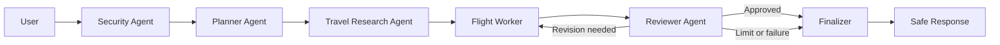

# AeroMind Travel Copilot

A multi-agent travel planning system built with LangGraph, OpenRouter, Tavily, Pydantic, Streamlit, and deterministic mock flight tools.

## Project Overview

AeroMind validates a user's travel request, extracts structured constraints, retrieves supporting travel context, searches mock flight options, reviews the plan against a budget and travel preferences, and produces a safe final response.

The deterministic mock catalog contains 15 airports, 389 bidirectional mock flight records, 8 airlines, direct routes, and region-aware stopovers.

## Project Structure

```text
src/aeromind/
├── agents/          # OpenRouter structured extraction and future agent services
├── tools/           # Mock flights, cost calculation, and Tavily research
├── security/        # Prompt-injection, PII, input, and output guardrails
├── observability/   # Structured logs and trace IDs
├── graph/           # LangGraph nodes and routing
├── evaluation/      # Benchmark utilities
├── models.py        # Pydantic and typed shared-state models
└── config.py        # Environment and API configuration

tests/               # Security, tools, workflow, and benchmark tests
notebooks/           # Submission notebook
app.py               # Streamlit interface
```

## Architecture



## Agents and Their Roles

- **Security Agent:** validates input length, detects prompt injection, and masks PII.
- **Planner Agent:** extracts origin, destination, budget, baggage, and direct-flight preferences.
- **Travel Research Agent:** uses Tavily only when a Tavily key is configured.
- **Flight Worker:** searches deterministic mock flights and calculates tax and baggage costs.
- **Reviewer Agent:** compares the plan with budget and direct-flight constraints.
- **Finalizer Agent:** formats a safe response and records the terminal reason.

## Technologies and AI Tools

- LangGraph and LangChain
- OpenRouter through an OpenAI-compatible model interface
- Tavily web search
- Pydantic
- Streamlit
- pytest
- Jupyter

## Installation

```powershell
py -3.13 -m venv .venv
.\.venv\Scripts\Activate.ps1
pip install -r requirements.txt
pip install -e .
```

Copy `.env.example` to `.env` and configure only the keys you have:

```text
OPENROUTER_API_KEY=
OPENROUTER_MODEL=openai/gpt-4o-mini
OPENROUTER_BASE_URL=https://openrouter.ai/api/v1
TAVILY_API_KEY=
MAX_REVISIONS=2
```

## Run Locally

```powershell
streamlit run app.py
```

Run the tests:

```powershell
pytest -q
```

Run a workflow directly:

```powershell
python -c "from aeromind.graph.workflow import AeroMindWorkflow; print(AeroMindWorkflow().run('أريد رحلة إلى دبي بميزانية 1200 ريال')[\"final_response\"])"
```

## Testing

The suite covers normal travel requests, unsupported destinations, prompt injection, PII masking, mock flight pricing, reverse routes, baggage pricing, stopover selection, all destination pairs, and benchmark results. The final local run passes 15 tests.

## Requirement Traceability

| Requirement | Evidence in project |
|---|---|
| Problem definition | README, notebook, and project overview |
| Three or more specialized agents | Security, Planner, Research, Worker, Reviewer, and Finalizer nodes in `src/aeromind/graph/workflow.py` |
| Orchestration and decision point | LangGraph conditional routing and bounded reviewer loop |
| Advanced reasoning | Plan extraction plus reflection/reviewer loop |
| External tool | Tavily research integration and deterministic flight/cost tools |
| Security guardrails | Prompt-injection detection, input validation, PII masking, and output budget validation |
| Monitoring | Trace IDs, timestamps, agent actions, tool status, durations, and errors |
| Testing | `tests/` with normal, invalid, failure, security, baggage, reverse-route, stopover, and coverage cases |
| Workflow explanation | `docs/architecture.md` and Mermaid diagrams |
| Submission documentation | This README, notebook, team page, and setup instructions |

## Google Colab

1. Upload this repository or clone it from GitHub.
2. Run `pip install -r requirements.txt`.
3. Add `OPENROUTER_API_KEY` and `TAVILY_API_KEY` to Colab Secrets.
4. Open `notebooks/AeroMind_Travel_Copilot.ipynb`.
5. Run all cells from top to bottom.

## Memory Model

AeroMind uses LangGraph shared state for agent communication, Streamlit session state for the short UI history, and bounded reflection with a maximum revision count. Long-term preference memory is not stored in the initial submission to minimize PII risk.

## Limitations

- Flight prices and availability are mock data and must not be presented as live bookings.
- Tavily supplies supporting context, not guaranteed live fare data.
- OpenRouter is optional; deterministic mock behavior remains available.
- No real payment or airline booking service is included.

## Future Improvements

- Add real flight APIs and booking authorization.
- Add SQLite short-term memory and checkpoint restoration.
- Improve OpenRouter structured extraction and date parsing.
- Add human approval and RBAC for sensitive actions.
- Add a live observability dashboard.

## Team

- [Abdullah Mohammed Alabdullah](https://github.com/xemprax-ctrl)
- [Abdullah Salem bin Ghafrah](https://github.com/aspsa1111-dot)

## Academy Links

- [SDAIA Academy GitHub](https://github.com/SDAIAAcademy)
- [Project Submission Form](https://forms.gle/nFPQGzTKGggWGWPx6)
