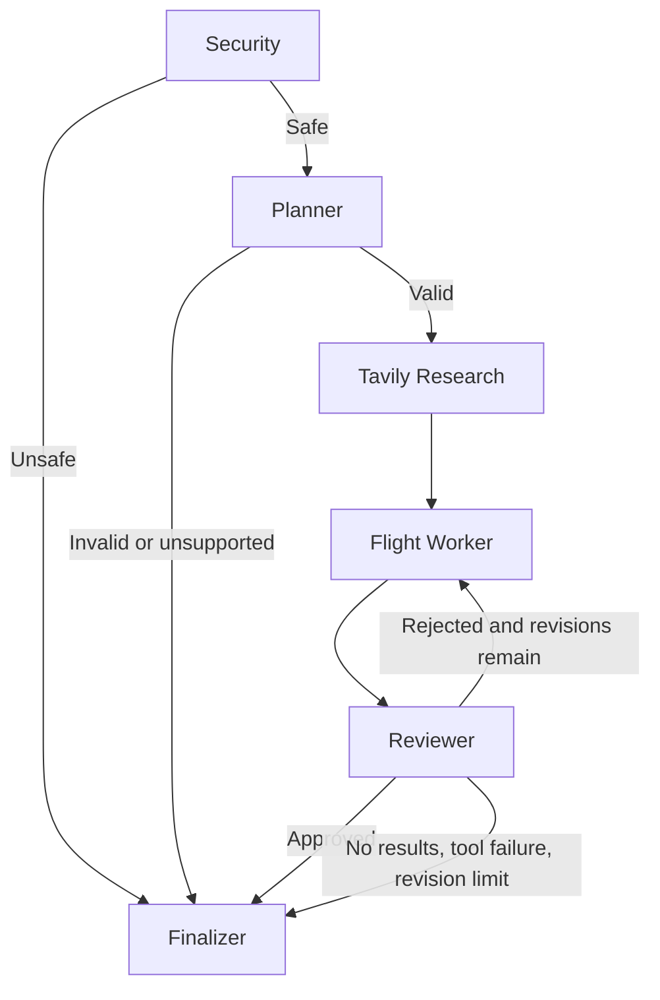

# Architecture and Workflow

## Shared State

LangGraph passes one typed `TravelState` object through every node. Each agent owns a specific set of fields:

- Security: `sanitized_query`, `error_message`, `terminal_reason`
- Planner: `origin`, `destination`, `max_budget`, `extra_bags`, `direct_only`
- Research: supporting research context
- Worker: `candidate_flights`, `selected_plan`
- Reviewer: `is_approved`, `critique_feedback`, `revision_count`
- Finalizer: `final_response`, `terminal_reason`

## Routing

## Reflection Limit

The worker/reviewer loop is limited to two revisions. It does not silently relax direct-only constraints or budget limits.

## External Tools

- Tavily retrieves supporting external context.
- Mock flight tools provide repeatable flight and cost data.
- OpenRouter is optional and may convert free text into structured planning fields.

## Observability

Every event contains a trace ID, timestamp, agent name, action, status, duration, and non-secret details. PII is masked before state and log output.
